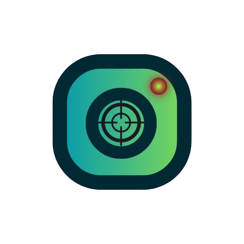
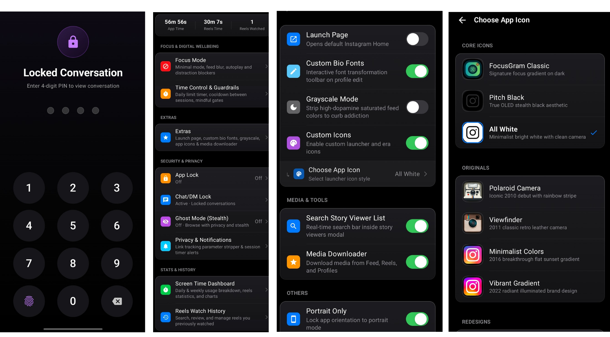

<div align="center"> 
 [ This APK Doesn't require the "Advanced Flow" to install on Android Devices. ]
</div>
<div align="center">



# FocusGram

**Use Instagram on your terms**

[](LICENSE)
[](https://developer.android.com)
[](https://github.com/Ujwal223/FocusGram/releases)
[](https://github.com/Ujwal223/FocusGram/releases)
[](https://focusgram.en.uptodown.com/android)
[](https://buymemomo.com/ujwal)

<br/>
</div>

---

## The Problem & The Solution

<p align="center">
  
</p>

Instagram is designed to hook your attention with autoplay videos, endless feeds, and nonstop recommendations. Most people do not want to quit Instagram entirely. You just want to chat with friends, check stories, and share photos without losing hours down an endless Reels rabbit hole.

FocusGram fixes this without modifying Instagram's app or using private APIs. It loads the clean mobile web version of Instagram inside a private, secure browser with built-in uBlock Origin. Ads get blocked, distractions stay hidden, and healthy timers keep you in control. Everything runs directly on your device, so your data and login stay completely private.

---

## FocusGram vs Official Instagram

| Feature | Official Instagram | FocusGram |
| :--- | :---: | :---: |
| **Ads & Sponsored Content** | Everywhere in feeds & stories | Completely blocked (uBlock Origin) |
| **Reels** | Endless scrolling trap | Block entirely or set timed sessions (1-30 min) |
| **Feed & Explore** | Constant recommendations | Option to blur or hide feeds until tapped |
| **Video Autoplay** | Plays automatically | Blocked, videos only play when you tap them |
| **Screen Time Limits** | Basic reminders | Strict daily limits and habit insights |
| **Mindfulness Gates** | None | Optional reflection pause, cooldowns, or typing challenge |
| **App & Chat Lock** | None | Lock the entire app or specific chats with PIN / Fingerprint |
| **Link Tracking** | Appends tracking tags (`igsh`, `fbclid`) | Automatically stripped before opening or sharing |
| **Data Privacy** | Telemetry and tracking | Zero tracking, zero analytics, 100% on-device |

---

## Core Capabilities

<table>
  <tr>
    <td width="50%">
      <h3>Focus Guardrails</h3>
      <ul>
        <li><b>Timed Reel Sessions</b>: Watch Reels in structured blocks (1-30 min) before a gentle pause.</li>
        <li><b>Daily Screen Time Limits</b>: Set strict daily quotas for overall usage.</li>
        <li><b>Mindfulness Breath Gate</b>: A reflection pause before entering the app.</li>
        <li><b>Cooldown Periods</b>: Enforce mandatory break intervals between sessions.</li>
      </ul>
    </td>
    <td width="50%">
      <h3>Calm Feeds & Content Control</h3>
      <ul>
        <li><b>Blur Explore & Feed</b>: Keep recommendation grids blurred until tapped.</li>
        <li><b>Autoplay Blocker</b>: Prevents intrusive video playback from hijacking attention.</li>
        <li><b>Minimal Mode</b>: Strips unnecessary clutter down to essential DMs and Feed.</li>
        <li><b>Grayscale Filter</b>: Eliminates vibrant dopamine colors on demand or on schedule.</li>
      </ul>
    </td>
  </tr>
  <tr>
    <td width="50%">
      <h3>Privacy & Security Locks</h3>
      <ul>
        <li><b>Biometric & PIN App Lock</b>: Secure the entire app behind Android Keystore authentication.</li>
        <li><b>Individual Chat Lock</b>: Lock specific sensitive direct message conversations with separate PINs.</li>
        <li><b>Link Sanitizer</b>: Strips <code>fbclid</code> and tracking parameters before sharing.</li>
        <li><b>Zero Data Transmission</b>: No telemetry, no analytics, no third-party network SDKs.</li>
      </ul>
    </td>
    <td width="50%">
      <h3>Native Android Experience</h3>
      <ul>
        <li><b>Modern Onboarding</b>: Clear guided setup explaining permissions and boundaries.</li>
        <li><b>Update Checker</b>: In-app GitHub release notifications with one-tap downloads.</li>
        <li><b>Dynamic Launcher Icons</b>: Custom app icons including OLED Pitch Black, Abstract, and Classic.</li>
        <li><b>Reel History & Local Snapshots</b>: Save and revisit content stored completely offline in Room DB.</li>
      </ul>
    </td>
  </tr>
</table>

---

## Quick Start

### Installation

- **Direct APK**: Download the latest release from [GitHub Releases](https://github.com/Ujwal223/FocusGram/releases). Available in architecture splits (`arm64-v8a`, `armeabi-v7a`, `x86_64`) and Universal APK.
- **Uptodown**: Download verified builds on [FocusGram on Uptodown](https://focusgram.en.uptodown.com/android).
- **Uncloned Edition (`com.instagram.android`)**: Replace the official Instagram app directly on your device via our [Uncloned Distribution Channel](https://focusgram.blogspot.com/).

---

### Building from Source

#### Prerequisites
- Android 8.0+ (API Level 26+)
- JDK 21 (Temurin / Adoptium recommended)
- Android SDK Command-line Tools (Build-Tools 35.0.0)

#### Build Commands

```bash
# Clone repository
git clone https://github.com/Ujwal223/FocusGram.git
cd FocusGram

# Run unit tests
./gradlew :app:testDebugUnitTest

# Build debug APK
./gradlew :app:assembleDebug

# Build standard release APKs (Universal & ABI splits)
./gradlew :app:assembleRelease

# Build uncloned edition with official package name (com.instagram.android)
./gradlew :app:assembleRelease -PuseInstaPackage=true

# Or launch the interactive build selector
./build-release.sh
```

---

## Security & Privacy Boundary

> [!IMPORTANT]
> **Why FocusGram Presents Instagram's Web Login Screen:**  
> Meta does not offer public OAuth or user-generated app passwords for third-party consumer apps. To connect to Instagram securely without risking account bans or scraping violations, FocusGram loads the official web login directly from `https://www.instagram.com/` inside an isolated Mozilla GeckoView browser session.

- **Zero Credential Interception**: The login interface is rendered inside GeckoView as a sealed black box. FocusGram's Kotlin codebase cannot inspect, intercept, or log passwords or 2FA codes.
- **Strictly Local Storage**: All settings, screen time stats, and session records stay encrypted on your phone.
- **No Third-Party SDKs**: Zero Google Firebase, zero analytics, zero crash reporting services, and zero network calls from Kotlin to external servers.

For detailed security architecture, threat model explanations, and vulnerability disclosure instructions, see **[SECURITY.md](SECURITY.md)**.  
For contribution guidelines and development standards, see **[CONTRIBUTING.md](CONTRIBUTING.md)**.

---

## Frequently Asked Questions

**Will this get my Instagram account banned?**  
No. FocusGram's web traffic is identical to accessing Instagram inside a standard Firefox or Chrome browser on Android. FocusGram does not use Instagram's private internal API, does not automate actions, and does not scrape content.

**Can I use FocusGram alongside the official Instagram app?**  
Yes! The default release uses package name `com.ujwal.focusgram` so it installs side-by-side with Instagram. If you wish to replace the official app completely so system links open in FocusGram automatically, build or download the Uncloned Edition (`com.instagram.android`).

---

## Legal Disclaimer

FocusGram is an independent, free, and open-source productivity tool licensed under AGPL-3.0. It is not affiliated with, endorsed by, or associated with Meta Platforms, Inc. or Instagram in any way.

- **How it works**: FocusGram embeds a sandboxed browser engine (Mozilla GeckoView) that loads `instagram.com`, the same website accessible in any mobile browser. All user-facing features operate exclusively via client-side modifications and are never transmitted to or processed by Meta's servers.
- **What we do not do**:
  - Use or alter Instagram's or Meta's private APIs
  - Intercept, read, log, or store user credentials, session data, or sensitive content
  - Modify any server-side Meta or Instagram services
  - Scrape, harvest, or collect any user data
  - Claim ownership of any Meta or Instagram trademarks, logos, or intellectual property
- **Terms**: Using FocusGram is functionally equivalent to accessing Instagram through a mobile web browser with a content blocker extension. By using FocusGram, you acknowledge that you remain bound by Instagram's Terms of Service.

For legal concerns, contact `notujwal@proton.me` before taking any other action.

---

## License & Support

Copyright (c) 2025-2026 [Ujwal Chapagain](https://github.com/Ujwal223).  
Licensed under the [GNU Affero General Public License v3.0 (AGPL-3.0)](LICENSE).

If FocusGram has helped you regain control of your attention, support continuous open-source development:

[](https://buymemomo.com/ujwal)
